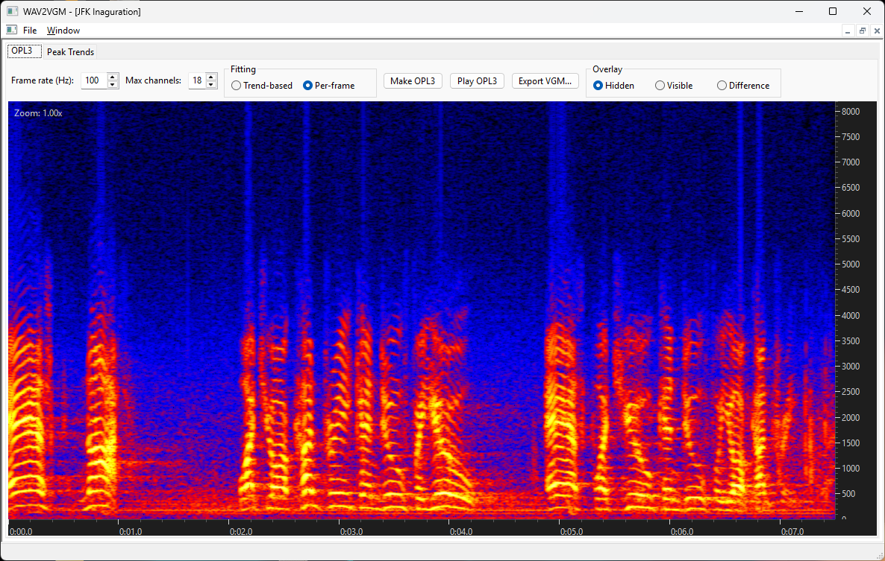
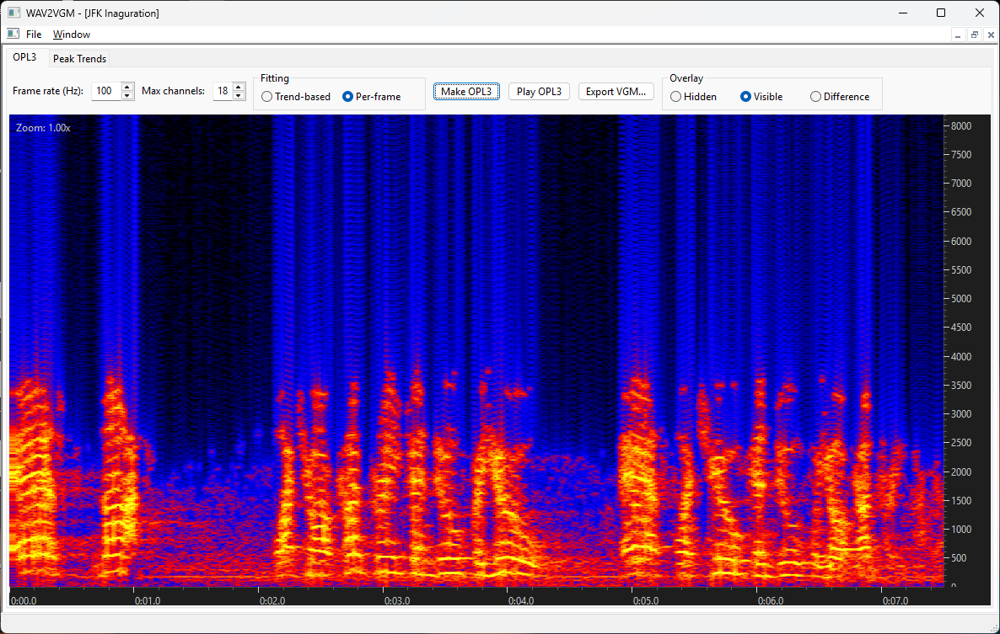
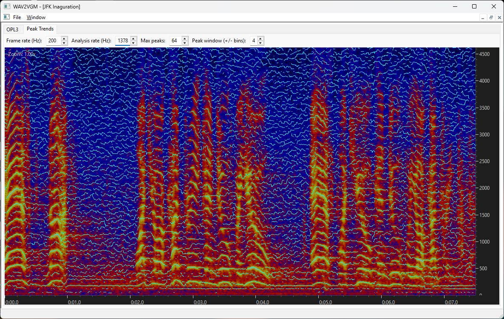

# WAV2VGM

A portable C++ GUI app that imports audio, normalizes it to mono 44.1 kHz,
and approximates it using real synth-chip register settings, as a simple
additive sum of sine-waves of varying frequencies and volumes. The result
can be exported as a standard VGM file playable on real hardware or any VGM
player, for any of ten sound chips (the OPL2/3/4, OPM and OPN families,
HuC6280, Virtual Boy VSU and MultiPCM), or as a General MIDI file.

This is a C++ rewrite of the original python3/pygame experiment which was
featured on Hackaday, and that version is still available in release v1.0.
The Python version is way messier, has broken features, and lacks a proper
UI, but it still might be better for casual hacking. Geek on!

## Example Output

The input folder has some example input WAV files, and the output folder has
their OPL3 VGM approximations (made before the other chips were supported).

| Input WAV | Output VGM | Rendered WAV |
| --- | --- | --- |
| [Grand Piano](input/Grand%20Piano.wav) | [Grand Piano](output/Grand%20Piano.vgm) | [Listen](output/001_Grand%20Piano_vgm.wav) |
| [HAL 9000 - Human Error](input/HAL%209000%20-%20Human%20Error.wav) | [HAL 9000 - Human Error](output/HAL%209000%20-%20Human%20Error.vgm) | [Listen](output/002_HAL%209000%20-%20Human%20Error_vgm.wav) |
| [JFK Inaguration](input/JFK%20Inaguration.wav) | [JFK Inaguration](output/JFK%20Inaguration.vgm) | [Listen](output/003_JFK%20Inaguration_vgm.wav) |
| [Tamayo Kawamoto and Capcom - Ghouls and Ghosts - The Village Of Decay](input/Tamayo%20Kawamoto%20and%20Capcom%20-%20Ghouls%20and%20Ghosts%20-%20The%20Village%20Of%20Decay.wav) | [Tamayo Kawamoto and Capcom - Ghouls and Ghosts - The Village Of Decay](output/Tamayo%20Kawamoto%20and%20Capcom%20-%20Ghouls%20and%20Ghosts%20-%20The%20Village%20Of%20Decay.vgm) | [Listen](output/004_Tamayo%20Kawamoto%20and%20Capcom%20-%20Ghouls%20and%20Ghosts%20-%20The%20Village%20Of%20Decay_vgm.wav) |
| [Wilhelm Scream](input/Wilhelm%20Scream.wav) | [Wilhelm Scream](output/Wilhelm%20Scream.vgm) | [Listen](output/005_Wilhelm%20Scream_vgm.wav) |

## Gallery

### Original WAV



### OPL3 Approximation



### Spectral Peak Analysis



## Output targets

Every target is driven as a bank of independent pure-sine voices:

| Chip | Sine voices | How each voice makes a sine |
| --- | --- | --- |
| OPL3 (YMF262) | 18 | 2-op channel, additive mode, sine carrier |
| OPL2 (YM3812) | 9 | same as OPL3, bank 0 only |
| OPL4 (YMF278B) | 18 FM / 24 PCM / 42 both | FM as OPL3; PCM slots loop a sine sample uploaded to sample RAM |
| OPM (YM2151) | 8 | algorithm 7, one operator per channel |
| OPN (YM2203) | 6 | algorithm 7; channel 3 in special mode gives 4 independent operators |
| OPNA (YM2608) | 9 | as OPN, 6 FM channels |
| OPN2 (YM2612) | 9 | as OPNA |
| HuC6280 | 6 | 32-step 5-bit sine wavetable |
| VSU (Virtual Boy) | 5 | 32-step 6-bit sine wavetable |
| MultiPCM (YMW258) | 28 | loops a sine sample from a small ROM embedded in the VGM |
| MIDI (General MIDI) | 16 | one monophonic GM Ocarina channel per voice (see below) |

Square-wave (SSG), noise, rhythm and ADPCM parts are left silent.

### MIDI output

The MIDI target exports a Standard MIDI File (format 1, 960 PPQN, 120 BPM)
instead of VGM:

- Up to 16 monophonic channels play GM program 80 (Ocarina), the closest
  thing to a pure sine in the GM set.
- The voice count defaults to 15, leaving channel 10 unused. Many GM
  synths always play channel 10 as drums and ignore any program change
  there. Raise it to 16 to use that channel. Channels fill in the order
  1-9, then 11-16, and channel 10 is used last.
- Each channel is set up with Omni Off and Mono On (CC124/CC126).
- The pitch-bend range is set through RPN 0 (CC101/CC100 = 0, then CC6),
  from 1 to 127 semitones; 24 is the default. Larger ranges mean fewer
  note restrikes on wide pitch movement, but coarser bends: the full
  127-semitone range is about 1.6 cents per bend step, while 24 is about
  0.3 cents. Changing the range after a fit is made takes effect on the
  next export without refitting.
- Pitch changes become pitch-bend messages around the current note. A
  new note is struck only at key-on, or when the pitch moves past the bend
  range. The new note-on comes before the old note-off, so mono-mode
  synths play it legato.
- Level changes become CC11 (Expression), using GM's 40*log10(cc/127)
  volume curve.
- Results depend on the synth: one that ignores Mono mode or uses a
  non-sine Ocarina patch won't sound like the in-app preview.

## Using the app

1. **File > Import WAV** opens the recording in a new project window, on
   the **Chip** tab.
2. Pick the output **Chip** from the dropdown. OPL4 adds a second dropdown
   for FM, PCM or FM + PCM voices; MIDI adds a **Bend range** control.
3. Set the **Frame rate** (register updates per second, 100 Hz by default)
   and **Max channels** (defaults to every voice the chip has; 15 for MIDI).
4. Choose a **Fitting** workflow (see below) and press **Make**. The status
   bar then shows the fit score.
5. **Play** previews the approximation. The **Overlay** radio box shows the
   fit over the spectrogram (Visible) or how far it is from the original
   (Difference).
6. **Export VGM...** (or **Export MIDI...** for the MIDI target) saves the
   result for the chip the fit was made for.

## Features

- Main window with File menu: Import WAV, Exit
- Child project windows (MDI) with one tab per analysis mode -- "Chip"
  (selected by default) and "Peak Trends" -- each holding its own
  scrollable/zoomable spectrogram view locked to that mode, plus that
  mode's own controls row directly above it. Selecting a tab selects the
  mode; there's no separate menu for it.
- Import a WAV file: downmix to mono, resample to 44.1 kHz (with an
  anti-aliasing/anti-imaging lowpass filter), amplitude-normalize, and
  build a real STFT spectrogram (parallelized across hardware threads --
  the default 32-sample hop means hundreds of thousands of FFT columns
  for a several-minute recording) mapped through a fixed 5-stop dBFS
  heatmap gradient (black/blue/red/yellow/white)
- **Chip mode**: fits up to the selected chip's voice count of pure-sine
  oscillators against the recording, renders the result for
  playback/comparison, and exports it as VGM (or MIDI). Pitch and volume
  are quantized to the chip's real registers, and each kind of voice is
  calibrated by rendering it. The OPL family is previewed through the
  vendored dbopl emulator; other chips are previewed with a built-in model
  of the chip's waveform, pitch and volume steps (`src/chips/`). Three
  fitting workflows are available:
  - **Trend-based** (`sinefit::FitChannelsInTurn`): one persistent channel
    per tracked peak trend, so identity is guaranteed but brief content is
    dropped.
  - **Per-frame** (`sinefit::FitChannelsPerFrame`, the default): every
    frame gets its own loudest peaks, channel = rank. Dense, but a channel
    can jump to a different partial from one frame to the next.
  - **Chains** (`sinefit::FitChannelsByChains`): extracts one continuous
    pitch path at a time from the residual spectrum by dynamic programming,
    gives it a voice for its whole lifetime, subtracts its leakage, and
    repeats; whatever residual is left (noise, fricatives, transients) then
    fills any still-free voices per frame. This keeps per-frame density
    while sustained partials stay on one voice, so there are far fewer
    re-attacks and pitch jumps. Levels of overlapping partials are solved
    jointly per frame, and peak frequency/level are interpolated between
    bins. It's the newest workflow and usually the closest fit, but can
    take noticeably longer on long recordings with many voices.
  - After each fit the status bar reports the *fit score*: similarity,
    average spectral error in dB, key-on count and pitch-jump count. That's
    the practical way to compare the three workflows on your own material.
- **Peak Trends mode**: tracks spectral peaks into persistent trend lines
  across the recording (additive sine-partial view of the signal) --
  currently more of a groundwork placeholder than a full workflow of its
  own
- Time-axis zoom/scroll stays in sync across tabs; each tab keeps its own
  independent vertical (Hz) range. The Chip tab's default vertical range
  follows the selected chip's playable range.
- Settings (last-used import/export folders, spectrogram FFT/hop size,
  selected chip, OPL4 mode and MIDI bend range) persist between runs in
  `WAV2VGM.ini` next to the executable

## Stack

- C++ with CMake + Ninja
- wxWidgets 3.2+ (cross-platform desktop UI)
- vcpkg for dependencies on Windows

## Build on Linux

1. Install wxWidgets 3.2 development packages.
   - Ubuntu/Debian: `sudo apt install libwxgtk3.2-dev`
2. Configure and build:
   - `cmake -S . -B build`
   - `cmake --build build`

## Build on Windows

The toolchain is **MSVC + vcpkg** — it's what most Windows C++ developers
already have, needs nothing beyond a standard Visual Studio install, and
every piece of the build shares one runtime (no GCC/MSVC-runtime ABI
matching to worry about).

1. Install **Visual Studio 2022 or later** (Community edition is fine) with
   the **"Desktop development with C++"** workload. That workload bundles
   everything needed — the MSVC compiler, CMake, Ninja, and vcpkg — with
   no separate downloads.
2. Open **"Developer PowerShell for VS 2022"** (or 2026, etc. — a Start
   Menu shortcut the installer creates) and set `VCPKG_ROOT` to the
   vcpkg bundled with your VS install, e.g.:

   ```powershell
   $env:VCPKG_ROOT = "C:\Program Files\Microsoft Visual Studio\<version>\Community\VC\vcpkg"
   ```

   (Set this once per shell session — or add it to your profile/environment
   permanently. If you'd rather manage vcpkg yourself, any vcpkg checkout
   with `bootstrap-vcpkg.bat` already run works the same way.)
3. From the repo root:
   - `cmake --preset windows`
   - `cmake --build --preset windows-debug`
4. Run `build/WAV2VGM.exe`.

For an optimized build use `cmake --preset windows-release` and
`cmake --build --preset windows-release` instead. The output goes to
`build-release/`. Release builds make fitting noticeably faster.

If configuring fails with a "Could not find a package configuration file
provided by wxWidgets" error, CMake isn't using vcpkg. Make sure
`VCPKG_ROOT` is set in the shell you configure from, and use the preset
(it passes vcpkg's toolchain file for you). If a `build/` folder was
earlier configured some other way (for example by a Visual Studio
"Open Folder" with a different generator), delete it first, because a
stale CMake cache keeps its old generator and its failed wxWidgets
lookup.

The first configure builds wxWidgets and its dependencies from source via
vcpkg (a few minutes); after that they're cached and later configures are
fast. vcpkg also copies the required runtime DLLs next to the executable
automatically (`VCPKG_APPLOCAL_DEPS`), so `build/` stays portable — copy
it elsewhere and it still runs.

## Tests and tools

`ctest` from the build directory runs the three self-tests below; each can
also be run directly (e.g. `build/chip_selftest.exe`).

- `dsp_selftest` validates the FFT/window/dBFS pipeline against a synthetic
  sine wave (checks peak-bin position, ~0 dBFS at full scale, and the
  5-stop color gradient).
- `opl3_selftest` covers the original OPL3-only pipeline (`OplChip`,
  `oplfit`, `vgm::WriteVgmFile`), which the OPL3 target is checked against:
  - the `OplChip` wrapper around the vendored emulator: a single-channel
    patch's rendered FFT peak lands on the frequency its F-number/block
    registers were set for;
  - the per-frame fitter (`FitAllFrames`/`RenderAllFrames`, a deterministic
    pure-sine fit with no search): expected frame count, a non-silent
    render, and identical timbre across frames of a sustained tone;
  - residual targeting: a second channel fit against the first channel's
    render picks up the tone the first one didn't cover, and stays silent
    on a single-tone input instead of re-fitting the same tone;
  - the trend-based multi-channel workflow (`FitChannelsInTurn`): it stays
    within the requested channel count, and its summed solo renders match
    a real joint emulation of the same channels almost exactly, confirming
    the additive-superposition assumption the fitters rely on;
  - VGM export: header fields a player relies on (magic, EOF offset, data
    offset, YMF262 clock), register writes present, proper terminator;
  - the older whole-recording fitters (`FitSingleChannel`, which searches
    FM modulator settings and operator waveforms, and `FitMultiChannel`/
    `RenderMix`), kept working but not wired into the UI.
- `chip_selftest` covers every chip target:
  - the OPL3 target reproduces the original OPL3-only pipeline byte for
    byte (VGM output and rendered mix, for the trend-based and per-frame
    workflows);
  - the Chains workflow: a four-frame burst still gets represented, a
    sustained tone isn't chopped into re-attacks, and on OPL4's FM + PCM
    target a tone out of FM's range lands on a PCM voice instead of being
    clamped;
  - each chip's register encoding is spot-checked against known values
    (e.g. OPM KC 0x4A = A4), a rendered voice peaks at the quantized pitch,
    and volume steps drop by what the level table says;
  - the fitting workflows find a two-tone input, and the exported VGM is
    well formed: clock at the spec-defined header offset, expected data
    blocks, and only known commands;
  - MIDI export: the file is parsed and every channel event replayed,
    checking that on every frame the sounding note plus pitch bend and the
    CC11 value match the fit; a gliding tone uses pitch bends, then a new
    note once it passes the bend range; each channel's setup messages
    (program, mono mode, RPN 0 range) are present; and channel 10 stays
    unused when nine voices are enough.

  Run `chip_selftest <dir>` to also write sample files into `<dir>`: a
  two-tone VGM and a one-tone-per-voice `_multi` VGM for every chip, plus
  `MIDI.mid`. Use them to check output in an external player such as
  libvgm's `vgm2wav`.
- `fit_bench <input.wav> [chip] [voices] [frameRateHz] [outDir]` (not part
  of `ctest`) runs all three fitting workflows on a real recording and
  prints their fit scores, density, timing and continuity counts side by
  side, writing each workflow's VGM too if `outDir` is given. `chip` is one
  of `opl3` (default), `opl2`, `opl4fm`, `opl4pcm`, `opl4both`, `opm`,
  `opn`, `opna`, `opn2`, `huc6280`, `vsu`, `multipcm`. That's the quickest
  way to judge a change against your own material instead of a synthetic
  test.

## Third-party components / licensing

This project vendors [`dbopl`](https://github.com/rofl0r/dbopl)
(`src/third_party/dbopl/`), the OPL3 (YMF262) emulator core extracted
from [DOSBox](https://www.dosbox.com/), copyright (C) 2002-2020 The
DOSBox Team, used unmodified to power the FM voices of the OPL3, OPL2 and
OPL4 targets. It is licensed under **GPL2+** (full text in
`LICENSE-GPL2.txt`). Because it's statically linked into the executable,
**any distributed build is a combined work under GPL2+ as a whole** — see
`NOTICE.md` for details.

`src/chips/OpmPhaseIncRom.h` holds the YM2151 phase increment table from
MAME's `ym2151.c` (by way of [libvgm](https://github.com/ValleyBell/libvgm)),
available under BSD-3-Clause or GPL2+. The other chip targets contain no
third-party code; libvgm's emulator cores and VGM player were used as a
reference.

## Credits

- Multi-chip VGM output, MIDI export and the Chains fitting workflow were
  contributed by [djtuBIG-MaliceX](https://github.com/djtuBIG-MaliceX)
  (PR #7). Thanks!

## Notes / known limitations

- Every target only uses plain sine waves. I'd really really like to take
  advantage of more synth features such as waveform shapes, square waves,
  noise, percussion, and OPL 2-op and 4-op sounds. (It's been difficult to
  graduate from plain sine-waves.)
- Hope to support more synthesizer types in the future, such as MOS SID,
  PSG, etc.
- Non-OPL previews use a model, not a full emulator. Pitches and levels
  match the real chips, and each voice's overall loudness is approximated
  from libvgm's cores, but exported VGMs are worth checking in a real
  player.
- OPL4 PCM and MultiPCM files carry their own sine sample in VGM data
  blocks. OPL4 needs no YRW801 ROM. MultiPCM's tiny embedded ROM is a VGM
  convenience rather than something original arcade hardware could load.
- MP3 import is not implemented (out of scope for this pass); the Import
  dialog only accepts `.wav`.
- The spectrogram defaults to 4096 samples per column (92ms) with a
  32-sample (0.072ms) hop between columns. Both are user-editable via
  `WAV2VGM.ini` (`FftSize`/`HopSize`, next to the executable, created on
  first run) rather than requiring a rebuild -- there's no in-app
  Preferences screen for them yet. `FftSize` must be a power of two;
  invalid values in the INI are ignored in favor of the default.
